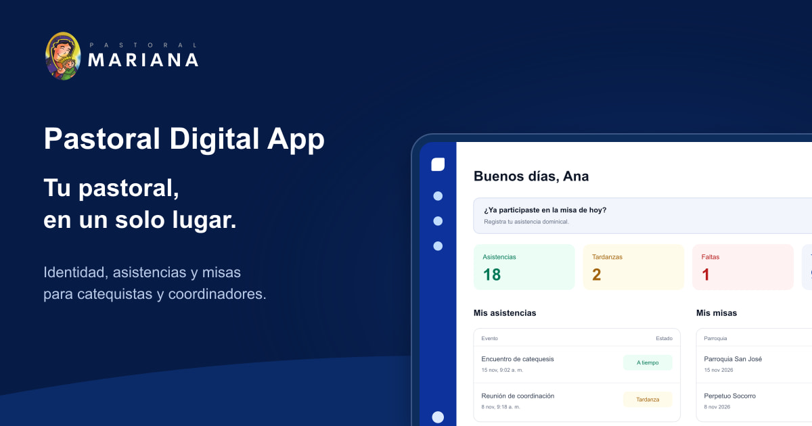

# Pastoral Digital App


[Reportar error](https://github.com/jpxoi/pastoral-digital-app/issues) · [Sugerir algo](https://github.com/jpxoi/pastoral-digital-app/issues)
[](https://deepwiki.com/jpxoi/pastoral-digital-app)

<details>

<summary>📖 Tabla de Contenidos</summary>

- [📄 Descripción](#-descripción)
- [✨ Características](#-características)
- [🆕 Novedades](#-novedades)
- [🚀 Primeros Pasos](#-primeros-pasos)
- [🚀 Desplegar la aplicación](#-desplegar-la-aplicación)
- [🤝 Contribuir](#-contribuir)
- [📜 Licencia](#-licencia)
- [📞 Contacto](#-contacto)

</details>

## 📄 Descripción

Pastoral Digital App es una aplicación web que permite a los catequistas de la Pastoral Mariana del CEP Nuestra Señora del Perpetuo Socorro acceder a un perfil digital con información de sus asistencias a las reuniones de catequesis, así como también a su identificación digital para el acceso a las actividades de la Pastoral Mariana.

## ✨ Características

Los catequistas pueden hacer lo siguiente dentro de la aplicación:

- 📲 **Pastoral Digital ID.** Identificador digital con código QR para registrar tu asistencia.
- 📅 **Registro de asistencias.** Visualización de fechas, horas y estado de asistencias.
- 👤 **Perfil de catequista.** Información personal, incluyendo nombre, foto y correo.

## 🆕 Novedades

La aplicación se encuentra en constante desarrollo, por lo que se irán añadiendo nuevas funcionalidades y mejoras en futuras versiones. Los _releases_ de la aplicación se publican de forma mensual en nuestra página de [Release Notes](https://jpxoi.notion.site/Pastoral-Digital-Release-Notes-292bc69d40434537996829014d6e6cb2)

## 🚀 Primeros Pasos

Esta aplicación es una _Progressive Web App_ (PWA) y puede ser instalada en cualquier dispositivo con un navegador web moderno. Para instalar la aplicación en tu dispositivo, sigue los siguientes pasos:

1. Abre la aplicación en tu navegador web favorito ingresando a la siguiente URL: [https://id.pastoralmarianaps.net.pe](https://id.pastoralmarianaps.net.pe).

2. Una vez que la aplicación haya cargado, busca la opción de "Instalar" en el menú de tu navegador. En Google Chrome, esta opción se encuentra en el menú de tres puntos verticales en la esquina superior derecha de la pantalla.

3. Haz clic en la opción de "Instalar" y sigue las instrucciones en pantalla para instalar la aplicación en tu dispositivo.

4. ¡Listo! Ahora podrás acceder a la aplicación desde tu pantalla de inicio y utilizarla como cualquier otra aplicación instalada en tu dispositivo.

> [!TIP]
> Recuerda tener conexión a Internet para utilizar la aplicación, ya que requiere una conexión activa para funcionar correctamente.

Si tienes alguna pregunta o problema con la instalación de la aplicación, por favor envía un correo electrónico a [pastoral@ps.edu.pe](mailto:pastoral@ps.edu.pe) para recibir asistencia.

## 🚀 Desplegar la aplicación

### 1. Clonar el repositorio

```bash
git clone https://github.com/jpxoi/pastoral-digital-app.git
cd pastoral-digital-app
```

### 2. Instalar las dependencias

```bash
pnpm install
```

### 3. Prerequisitos

La aplicación depende de los siguientes servicios:

- [Neon](https://neon.tech/) - Base de datos (PostgreSQL)
- [Clerk](https://clerk.com/) - Autenticación (Auth)
- [Uploadthing](https://uploadthing.com/) - Almacenamiento de archivos (Storage)
- [JSON.pe API](https://json.pe/api-dni) - Consulta de identidad (DNI)

Asegúrate de tener las credenciales de cada servicio y configurarlas en el archivo `.env`, como se especifica en el siguiente punto.

### 4. Configurar las variables de entorno

La aplicación utiliza variables de entorno para configurar su comportamiento. Estas variables se encuentran en el archivo `.env` y se pueden modificar según sea necesario. Si no tienes un archivo `.env`, puedes crearlo como el siguiente:

```env
DATABASE_URL=<your-neon-database-url>

NEXT_PUBLIC_CLERK_PUBLISHABLE_KEY=<your-clerk-publishable-key>
CLERK_SECRET_KEY=<your-clerk-secret-key>
CLERK_WEBHOOK_SIGNING_SECRET=<your-clerk-webhook-signing-secret>

INTERNAL_API_TOKEN=<token-aleatorio-de-256-bits>

NEXT_PUBLIC_CLERK_SIGN_IN_URL=/sign-in
NEXT_PUBLIC_CLERK_SIGN_UP_URL=/sign-up
NEXT_PUBLIC_CLERK_SIGN_IN_FALLBACK_REDIRECT_URL=/dashboard
NEXT_PUBLIC_CLERK_SIGN_UP_FALLBACK_REDIRECT_URL=/onboarding
NEXT_PUBLIC_CLERK_SIGN_UP_FORCE_REDIRECT_URL=/onboarding

UPLOADTHING_TOKEN=<your-uploadthing-token>

JSONPE_API_KEY=<your-json-pe-api-key>

NEXT_PUBLIC_VAPID_PUBLIC_KEY=<your-vapid-public-key>
VAPID_PRIVATE_KEY=<your-vapid-private-key>
VAPID_SUBJECT=mailto:pastoral@ps.edu.pe
CRON_SECRET=<token-aleatorio-de-256-bits>
```

#### Webhooks de Clerk

Configura en Clerk un endpoint `POST /api/webhooks/clerk` para los eventos `user.updated` y `user.deleted`. En producción, usa la URL pública de la aplicación; para desarrollo local, expón el servidor local con un túnel HTTPS.

Guarda el signing secret del endpoint en `CLERK_WEBHOOK_SIGNING_SECRET`. El handler usa `verifyWebhook` de Clerk, que lee esta variable por defecto y valida la firma antes de procesar cada evento. En `user.updated`, la aplicación sincroniza el correo principal con la base de datos y conserva como fuente de verdad el nombre guardado allí. En `user.deleted`, elimina los datos asociados de la base y programa con `after()` la eliminación de los archivos de evidencia en UploadThing.

El servidor de esta aplicación lee el secreto desde `INTERNAL_API_TOKEN`. En el backend que consume las APIs puedes guardarlo bajo el nombre sugerido `PASTORAL_API_TOKEN`; ese nombre es local y puedes elegir otro. Envía su valor en el encabezado `Authorization: Bearer <token>`. Mantén el secreto solo en servidores, nunca en código del navegador ni en variables `NEXT_PUBLIC_*`. Genéralo con `openssl rand -hex 32`, que produce 256 bits de entropía (64 caracteres hexadecimales). La especificación OpenAPI y los modelos de respuesta están en [`docs/internal-api.openapi.yaml`](docs/internal-api.openapi.yaml). Los endpoints disponibles son `GET /api/internal/catechists` y `GET /api/internal/events`.

#### Notificaciones Web Push

Se utiliza `web-push` con VAPID. Genera un par de claves una sola vez:

```sh
pnpm exec web-push generate-vapid-keys --json
```

Configura estas variables localmente y en el entorno de producción de Vercel:

```env
NEXT_PUBLIC_VAPID_PUBLIC_KEY=<publicKey>
VAPID_PRIVATE_KEY=<privateKey>
VAPID_SUBJECT=mailto:pastoral@ps.edu.pe
CRON_SECRET=<secreto-aleatorio-de-al-menos-32-caracteres>
```

La clave privada y `CRON_SECRET` permanecen exclusivamente en el servidor. Conserva el mismo par VAPID entre despliegues: cambiarlo obliga a renovar las suscripciones de los dispositivos. `CRON_SECRET` protege las rutas de envío; Vercel lo envía como `Authorization: Bearer …`.

El esquema incorpora `push_subscriptions` y `push_deliveries`, con identificadores `uuidv7()`. Estas tablas deben existir antes de activar las notificaciones. La generación y aplicación de migraciones se realiza por separado.

Los tres [Vercel Schedules](https://vercel.com/docs/schedules) se declaran en `vercel.json`, con zona `America/Lima` y jitter de 15 minutos compatible con Hobby:

| Schedule         | Horario de Perú                    | Destinatarios                                                                         |
| ---------------- | ---------------------------------- | ------------------------------------------------------------------------------------- |
| `push-events`    | Viernes y sábados a las 6:00 p. m. | Todos los suscritos, por cada evento del día siguiente. Solo muestra el primer turno. |
| `push-masses`    | Domingos a las 5:00 p. m.          | Suscritos sin registro de misa de ese domingo.                                        |
| `push-birthdays` | Todos los días a las 9:00 a. m.    | Saludo al cumpleañero y un aviso agrupado de los demás cumpleaños a cada suscrito.    |

El registro de misa abre el domingo a las 00:00 y cierra el lunes a las 12:00 p. m., en `America/Lima`. Inicio y Mis misas comparten el diálogo y la regla de horario. El servidor también valida el plazo al registrar y antes de autorizar una subida mediante `sundayMassEvidenceUploader`; las URLs de subida duran cinco minutos. Al completarse una subida autorizada, el callback guarda su referencia en `mass_evidence_files` sin volver a comprobar el horario ni eliminar el archivo. Esto no registra la misa: el envío del formulario sigue sujeto al plazo. Solo se permite un registro por usuario y domingo; un rechazo es definitivo y no habilita un nuevo envío.

Los cambios efectivos de estado de misa o asistencia disparan un envío después de guardar la operación, mediante `after()`. Los avisos de asistencia no revelan estados. Las notificaciones se activan desde Inicio o desde el menú de cuenta → Notificaciones, con un único permiso por dispositivo. En iPhone/iPad debe abrirse la PWA instalada en la pantalla de inicio. Cerrar sesión desde el menú desactiva la suscripción de ese dispositivo.

Los envíos masivos consultan dispositivos y usuarios con un join, filtran misas ya registradas en esa misma consulta y reservan todas las entregas del lote con un único `INSERT … SELECT … ON CONFLICT DO NOTHING`. Los avisos de revisión de misas y actualización de asistencias también agrupan usuarios y consultan sus dispositivos por páginas de 100, sin consultas por usuario. La selección y la reserva se mantienen en dos consultas por lote. Las peticiones al servicio push se procesan de diez en diez; la limpieza de suscripciones caducadas y entregas fallidas comparte un único batch HTTP. La consulta de cumpleaños y la limpieza diaria también comparten un batch. El registro de entregas se conserva 90 días y evita repetir envíos ya reservados.

Los horarios son aproximados por el jitter. Los handlers usan `ce-vssscheduledat` y descartan ejecuciones de más de 30 minutos para evitar recordatorios tardíos. Los targets `path` de Schedules no reintentan automáticamente; los errores se reflejan en sus logs y en una respuesta 503. Una repetición dentro de esa ventana, con la misma fecha programada, reintenta las entregas fallidas sin repetir las reservadas correctamente. Web Push no garantiza que el usuario vea o lea el aviso; una interrupción del proceso después de reservar puede dejar una entrega sin enviar.

Pruebas locales sin enviar notificaciones reales:

```sh
pnpm exec tsx --test tests/mass-registration.test.ts tests/push-jobs.test.ts
```

### 5. Generar las migraciones de la base de datos

La aplicación utiliza Drizzle para la generación de las migraciones de la base de datos. Para generar las migraciones, puedes ejecutar el siguiente comando:

```bash
pnpm db:generate
pnpm db:migrate
```

### 6. Desplegar la aplicación

La aplicación se puede desplegar en cualquier servidor que tenga Node.js y npm instalado. Para desplegar la aplicación, puedes ejecutar el siguiente comando:

```bash
pnpm build
pnpm start
```

Como alternativa, puedes utilizar el servicio de [Vercel](https://vercel.com/) para desplegar la aplicación. Para desplegar la aplicación en Vercel, puedes seguir los siguientes pasos:

1. Ingresar a la consola de Vercel en [https://vercel.com/](https://vercel.com/).
2. Crear una nueva proyecto.
3. Importar el repositorio de la aplicación.
4. Desplegar la aplicación.

## 🤝 Contribuir

Las contribuciones a la aplicación son bienvenidas y pueden realizarse a través de _pull requests_ en este repositorio.

### ¿Cómo contribuir?

Si tienes alguna sugerencia que podría mejorar el proyecto, por favor haz un [_fork_](https://github.com/jpxoi/pastoral-digital-app/fork) del repositorio y crea una [_pull request_](https://github.com/jpxoi/pastoral-digital-app/pulls). También puedes simplemente abrir un [_issue_](https://github.com/jpxoi/pastoral-digital-app/issues) con la etiqueta `enhancement`.

### ¿Quiéres ser parte del equipo de desarrollo?

Si deseas ser parte del equipo de desarrollo de la aplicación, por favor envía un correo electrónico a [pastoral@ps.edu.pe](mailto:pastoral@ps.edu.pe) con el asunto "Quiero ser parte del equipo de desarrollo de la Pastoral Digital App" y cuéntanos un poco sobre ti y por qué te gustaría ser parte del equipo.

## 📜 Licencia

Pastoral Digital App © 2025 por Jean Paul Fernandez está licenciado bajo Creative Commons Attribution-NonCommercial-ShareAlike 4.0 International. Para ver una copia de esta licencia, visita [https://creativecommons.org/licenses/by-nc-sa/4.0/](https://creativecommons.org/licenses/by-nc-sa/4.0/).


Esta licencia permite a los reutilizadores distribuir, remezclar, adaptar y desarrollar el material en cualquier medio o formato únicamente con fines no comerciales y siempre que se otorgue la atribución al creador. Si remezcla, adapta o construye sobre el material, debe licenciar el material modificado bajo términos idénticos. [CC BY-NC-SA](https://creativecommons.org/licenses/by-nc-sa/4.0/) incluye los siguientes elementos:

- **BY:** El crédito debe ser otorgado al creador.
- **NC:** Sólo se permiten usos no comerciales de la obra.
- **SA:** Las adaptaciones deben compartirse en los mismos términos.

## 📞 Contacto

Si deseas contactar con el equipo de desarrollo de la aplicación, puedes hacerlo a través de la dirección de correo electrónico [pastoral@ps.edu.pe](mailto:pastoral@ps.edu.pe) incluyendo en el asunto del mensaje "Pastoral Digital App".
